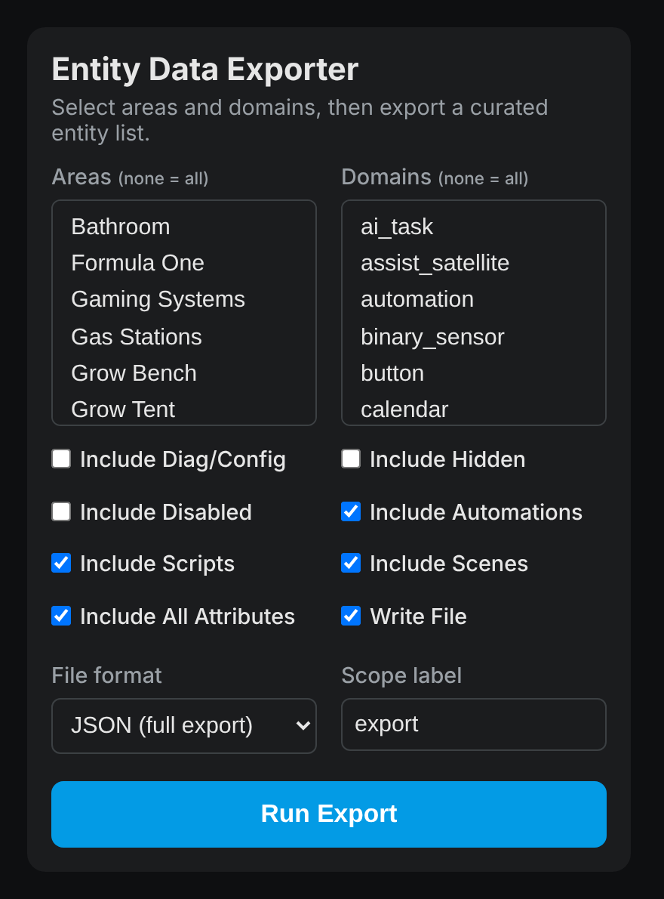

# Entity Data Exporter

[](https://github.com/cobragt2000/data_exporter/actions/workflows/validate.yml)
[](https://github.com/hacs/integration)
[](https://analytics.home-assistant.io/)

[](https://github.com/cobragt2000/data_exporter/releases)
[](https://github.com/cobragt2000/data_exporter/releases)
[](LICENSE)

A Home Assistant custom integration that produces a **curated** list of your
entities — filtered by area and domain, with the junk entities (diagnostic/config,
hidden, and disabled) dropped — so you can hand a clean, actionable inventory to
an LLM for automation design. By default each entity keeps **all** of its
attributes so the LLM sees the full picture; you can switch on noise-stripping
(or an allowlist) when you want a leaner payload.

It ships with a **custom Lovelace card** for point-and-click exports and a
**service/action** you can call from Developer Tools, scripts, or automations.

<p align="center">
  
</p>

## How the filtering works

Home Assistant already classifies most of the "junk" for you in the entity
registry, so this integration leans on that instead of a brittle blocklist:

| What | How it's dropped |
|------|------------------|
| Diagnostic / config entities (RSSI, battery %, uptime, firmware, etc.) | `entity_category` is `diagnostic`/`config` → dropped by default |
| Hidden entities | `hidden_by` is set → dropped by default |
| Disabled entities | `disabled_by` is set → dropped by default |

**Attributes are kept in full by default** (`include_all_attributes: true`) so
the LLM sees everything each entity exposes — supported features, color modes,
and the like. Turn `include_all_attributes` **off** to strip a built-in noise
list (rssi, voltage, linkquality, battery, supported_features, attribution, …)
from each entity's attribute payload.

On top of that you can still pass **manual overrides** (`exclude_entities`,
`exclude_attributes`) and an allowlist (`include_attributes`, which overrides
the above and keeps only the listed attributes). Each entity auto-filter can be
turned off per-call (`include_diagnostic`, `include_hidden`, `include_disabled`).

> **Battery readings:** "battery" is a `device_class` on the `sensor` domain,
> not a domain of its own. Battery sensors are usually tagged *diagnostic*, so
> to include them pick the `sensor` domain (or leave domains empty) and turn on
> `include_diagnostic`.

## Automations, scripts & scenes in the export

With `include_automations`, `include_scripts`, and `include_scenes` on (all
default), the export also contains every automation, script, and scene with its
**full config** (triggers/conditions/actions/sequence/target states, mode),
current state, and the **entities, devices, and areas it references**. This
gives a downstream LLM both halves of the picture — the devices available *and*
what's already automated against them — for a much better analysis. It covers
both UI-created and YAML items.

### Area-aware logic filtering

Logic follows the area selection using **containment**: when you select one or
more areas, an automation/script/scene is included only if *every* area it
touches is within your selection. So a room-specific automation shows up for its
room, but a house-wide one (say a "smart plug offline" alert spanning six areas)
does **not** get pulled into a single-room export just because it also touches
that room. To get everything, **leave the area filter empty**. Each logic record
reports the resolved `areas` it touches, so the relevance is visible in the
output.

An item's areas are resolved from everything it references — the areas of its
referenced entities and devices, plus any directly-referenced areas. An
automation that references only unassigned entities has no resolvable area and
is excluded while an area filter is active (it appears in an all-areas export).

## Installation (HACS)

1. In HACS, open the three-dot menu → **Custom repositories**.
2. Add `https://github.com/cobragt2000/data_exporter` with category
   **Integration**.
3. Search for **Entity Data Exporter**, install it, and **restart Home
   Assistant**.
4. Go to **Settings → Devices & Services → Add Integration**, search for
   **Entity Data Exporter**, and add it. (It's set up via the UI — no
   `configuration.yaml` edit needed.)

The Lovelace card is bundled and auto-registered — no manual resource entry
needed.

### Manual installation

Copy `custom_components/data_exporter/` into your HA `config/custom_components/`
directory, restart, then add the integration from **Settings → Devices &
Services → Add Integration**.

## Usage

### Via the card

Add a card to any dashboard:

```yaml
type: custom:data-exporter-card
title: Entity Data Exporter   # optional
```

Pick areas and domains (both multi-selects list **every area and domain in your
Home Assistant**; leave empty for "all"), toggle whether to include
diagnostic/hidden/disabled entities and automations/scripts/scenes, choose the
**file format** (JSON or CSV), and hit **Run Export**. The card reports the
entity count and the file path.

### Via the action

Developer Tools → **Actions** → `data_exporter.export_data`, or in YAML:

```yaml
action: data_exporter.export_data
data:
  areas:
    - living_room
    - kitchen
  domains:
    - light
    - switch
    - climate
  include_diagnostic: false
  write_file: true
  scope: downstairs
```

To get the data back inline (shown in Developer Tools, or usable in a script
variable) add `return_response: true`:

```yaml
action: data_exporter.export_data
data:
  domains: [light, switch]
response_variable: curated
```

The response and the written file both look like:

```json
{
  "metadata": {
    "timestamp": "2026-10-08T10:15:00",
    "scope": "downstairs",
    "entity_count": 42,
    "filters": { "areas": ["living_room"], "domains": ["light"], "...": "..." }
  },
  "entities": [
    {
      "entity_id": "light.living_room_lamp",
      "name": "Living Room Lamp",
      "domain": "light",
      "area": "Living Room",
      "device": "Hue Lamp",
      "device_class": null,
      "state": "on",
      "attributes": { "brightness": 180, "color_temp_kelvin": 2700 }
    }
  ],
  "automations": [
    {
      "entity_id": "automation.evening_lights",
      "alias": "Evening Lights",
      "id": "1700000000000",
      "state": "on",
      "mode": "single",
      "last_triggered": "2026-10-07T23:01:00+00:00",
      "referenced_entities": ["light.living_room_lamp"],
      "referenced_devices": [],
      "referenced_areas": ["living_room"],
      "config": {
        "alias": "Evening Lights",
        "trigger": [{ "platform": "sun", "event": "sunset" }],
        "condition": [],
        "action": [{ "service": "light.turn_on", "target": { "entity_id": "light.living_room_lamp" } }],
        "mode": "single"
      }
    }
  ]
}
```

Files are written to the config directory as
`ha_entities_<scope>_<timestamp>.json` (or `.csv` when `format: csv`).

With `format: csv`, the written file is the flat **entity list** only — one row
per entity with columns `entity_id, name, domain, area, device, device_class,
state, attributes` (the attributes dict is JSON-encoded into that single
column). Automations, scripts, and scenes are nested structures and stay in the
JSON export; the inline service response is always the full structured JSON
regardless of `format`.

### Service parameters

| Field | Type | Default | Description |
|-------|------|---------|-------------|
| `areas` | list | all | Area ids or friendly names to include |
| `domains` | list | all | Domains to include — **any** HA domain (`light`, `switch`, `climate`, `sensor`, …). The card lists every domain in your HA; the action's dropdown lists the standard domains and accepts custom values too |
| `include_diagnostic` | bool | `false` | Include diagnostic/config entities |
| `include_hidden` | bool | `false` | Include hidden entities |
| `include_disabled` | bool | `false` | Include disabled entities |
| `include_automations` | bool | `true` | Include full automation configs + what they reference (area-filtered) |
| `include_scripts` | bool | `true` | Include full script configs + what they reference (area-filtered) |
| `include_scenes` | bool | `true` | Include scene configs + what they reference (area-filtered) |
| `include_all_attributes` | bool | `true` | Keep every attribute per entity; set `false` to strip the built-in noise list |
| `exclude_attributes` | list | — | Attribute names to strip (applied on top of the above) |
| `include_attributes` | list | — | Allowlist: keep only these attributes (overrides the two above) |
| `exclude_entities` | list | — | Specific entity_ids to drop |
| `write_file` | bool | `true` | Write the export file to config |
| `format` | string | `json` | Written file format: `json` (full export) or `csv` (flat entity list) |
| `scope` | string | `export` | Label used in filename + metadata |

## Requirements

- Home Assistant 2024.7.0 or newer.

## License

MIT — see [LICENSE](LICENSE).
